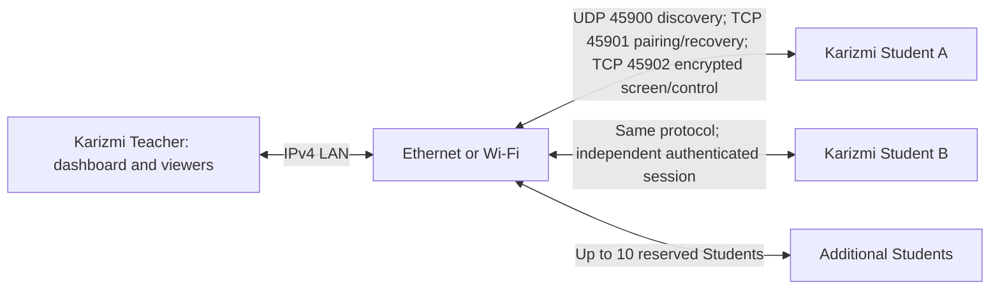

# Karizmi Exam Monitoring System

**Karizmi EMS ? Monitor Smarter. Examine Better. Stay Offline.**

**Development Preview ? Windows 10/11 x64 ? C++20 ? Win32 ? UltraVNC ? TCP/IP ? UDP ? Botan ? TLS 1.3**

## Overview

Karizmi EMS helps teachers observe student computers during practical examinations on an IPv4 Ethernet or Wi-Fi LAN. Karizmi Teacher provides a centralized classroom dashboard; Karizmi Student shares its desktop after authenticated pairing. Runtime operation requires no internet, cloud account, or external pairing server. Building dependencies initially requires internet access.

This native Windows project extends and customizes the open-source UltraVNC capture and viewer engines. It is a development preview, with unresolved physical-network validation and no independent security review. It is not production-certified.

## Key features and evidence

| Implemented capability | Evidence and limits |
| --- | --- |
| Separate native Teacher and Student applications | Win32 interfaces and engine integration in source |
| Dashboard with up to ten reserved student sessions | Ten encrypted peers tested locally; ten simultaneous physical desktop sessions remain unvalidated |
| Remote screen viewing and optional keyboard/mouse control | Starts View Only; Student enforces control permission; one controlled Student at a time |
| LAN discovery and authenticated pairing | IPv4 UDP discovery, eight-digit SRP pairing, mutual phrase confirmation |
| TLS 1.3 encrypted transport | Botan external-PSK TLS with X25519 and AES-128/GCM; automated security/socket tests recorded |
| Connection and session recovery | Same-sign-in protected approvals and retry logic implemented; latest physical discovery/outage repair remains unconfirmed |

An earlier version of Karizmi EMS was successfully tested by the developer using three physical laptops connected over a local area network. This is a developer-reported functional testing milestone and does not constitute comprehensive validation of the latest build.

## System architecture



Discovery labels are unverified hints. Pairing derives TLS credentials using SRP-6a and HKDF; both users confirm a phrase before monitoring. Discovery and bootstrap metadata are not all encrypted. See the [technical specification](karizmi/TECHNICAL-SPECIFICATION.md) for boundaries and lifecycle details.

## Technical stack

Custom components use C++20, Win32 APIs, Winsock, Windows Firewall COM APIs, and DPAPI. UltraVNC supplies the customized legacy screen-capture/viewer engines. Botan 3.13.0 is source-built and checksum-pinned. The root vcpkg manifest pins a baseline for zlib, zstd, libjpeg-turbo, liblzma, libsodium, and minizip-ng, with transitive dependencies including bzip2. Builds use MSVC, Windows SDK, CMake 3.24+, Ninja, Python 3.12+, and MSBuild. Full details: [build guide](BUILD-KARIZMI.md).

## Installation and usage

There is no official preview release established by this preparation. Existing repository archives are historical candidates, not approved release assets. Build both applications from source or use a future maintainer-published Development Preview after checking its notes and checksums. See the [release plan](karizmi/RELEASE-PLAN.md).

1. Use Windows 10/11 x64 computers on a LAN that permits peer traffic. Extract the entire Teacher or Student package; keep Student with `vnchooks.dll`.
2. Run `KarizmiStudent.exe`, accept its monitoring notice, open it from the tray, and choose **Set up exam connection**. Run `KarizmiTeacher.exe` and complete the same setup.
3. Approve the setup UAC prompt for temporary executable-scoped Windows Firewall rules. Student discovery uses UDP 45900, pairing/recovery TCP 45901, and screen/control TCP 45902. Do not disable the firewall. Managed policy, blocked local rules, or Wi-Fi client isolation may prevent access.
4. Select the discovered Student in Teacher, enter the Student's eight-digit code, and choose **Pair selected**. Compare and confirm the phrase on both computers.
5. Double-click a tile to view the screen. Viewing and recovery start View Only. Request control separately; Student must acknowledge permission. **Disconnect** revokes a pairing; **End exam** revokes all pairings. Closing the main window hides it to the tray; use **Exit** to quit.

The optional Student service requires separate installation; portable launch does not install it. See [service instructions](karizmi/SERVICE.md) and [classroom controls](karizmi/CLASSROOM.md).

## Building from source

From the repository root on Windows with the prerequisites in the [build guide](BUILD-KARIZMI.md):

```powershell
powershell -NoProfile -ExecutionPolicy Bypass -File karizmi/tools/Build-Apps.ps1
```

Default package directories: `karizmi/out/Teacher` and `karizmi/out/Student`. The full build runs shared-component tests before packaging. These are rebuild instructions; byte-for-byte reproducibility is not established. See the [preparation audit](karizmi/PORTFOLIO-AUDIT.md) for checks actually run during this work.

## Testing and validation

Historical development records report four automated suites (core, security, network, UI), synthetic DPI checks, ten local encrypted peers, and earlier same-PC paired GUI acceptance. These scopes differ from physical classroom testing and do not certify every latest binary. The developer-reported three-laptop milestone above concerns an earlier version. Latest physical discovery/recovery failures remain open until retested.

See [recovery evidence](karizmi/RECOVERY-VALIDATION.md), [UI evidence](karizmi/UI-VALIDATION.md), and the [current specification](karizmi/TECHNICAL-SPECIFICATION.md). Some historical logs and screenshots referenced there exist only in ignored local build directories.

## Project structure

| Path | Purpose |
| --- | --- |
| [karizmi](karizmi/README.md) | Custom application, protocol, security, classroom, service, tests, and documentation |
| `karizmi/src`, `karizmi/include` | Custom modules and Teacher/Student engine adapters |
| `karizmi/tools`, `karizmi/tests` | Build/support tools and automated tests |
| [Karizmi.Engine.props](karizmi/Karizmi.Engine.props) | Isolated MSBuild settings and integration objects |
| `vncviewer`, `winvnc` | Upstream-derived viewer/capture source with guarded Karizmi integration |
| `common`, `rfb`, `rdr`, `3rdparty`, other root modules | Retained upstream infrastructure and dependencies |
| `karizmi/out-*` | Historical package artifacts; preserved, not an official release channel |

## Acknowledgments and licensing

Thanks to the [UltraVNC developers](https://github.com/ultravnc/UltraVNC) for the original engines. The root [LICENSE](LICENSE) contains GNU GPL version 3. Existing source copyright and license notices remain authoritative and must be retained. Botan uses BSD-2-Clause. See [third-party notices and review gaps](karizmi/THIRD-PARTY-NOTICES.md); a root license copy alone does not establish distribution compliance or complete corresponding source for old binaries.

## Development roadmap

- Reproduce and close physical discovery and unplug/replug recovery failures on latest packages.
- Validate two independent live Students, cross-target input isolation, adapter/IP changes, and ten-device classroom capacity.
- Expand rotation/teardown failure injection, sign-out/restart/sleep, service, firewall, and Explorer-restart acceptance.
- Obtain independent security review of pairing, TLS composition, recovery, and privileged firewall helper.
- Consider configurable ports, transactional listener changes, stale-rule ownership cleanup, adapter notifications, and concurrent Student bootstrap processing.
- Complete dependency/source provenance and release acceptance gates before publishing a preview.

## Screenshots and demonstrations

No tracked application screenshots were found during preparation; the branding image is not an application capture. Historical local screenshot references are preserved as evidence references, not embedded as published images. Future demonstrations should capture the Teacher dashboard, discovery list, pairing confirmation, multiple live Students, remote control, and outage recovery using test identities and no visible secrets. See [portfolio copy and capture checklist](karizmi/PORTFOLIO.md).

Contributors: follow the [contribution guide](CONTRIBUTING.md) and distinguish source inspection, automated results, and physical acceptance in reports.
